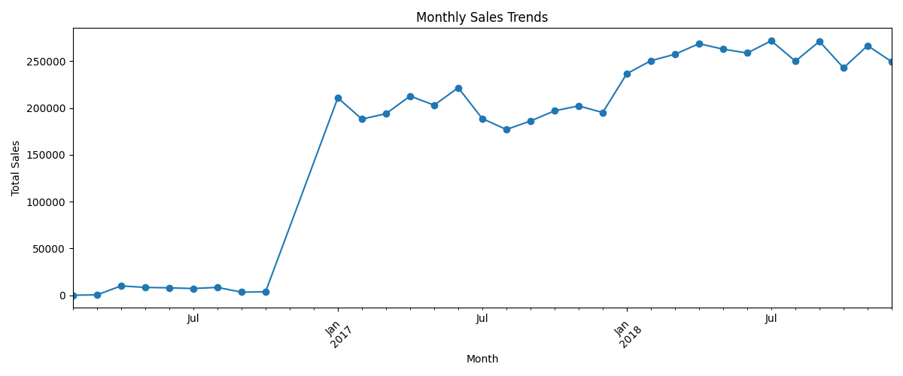
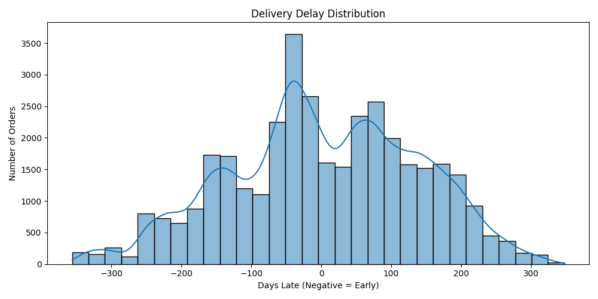
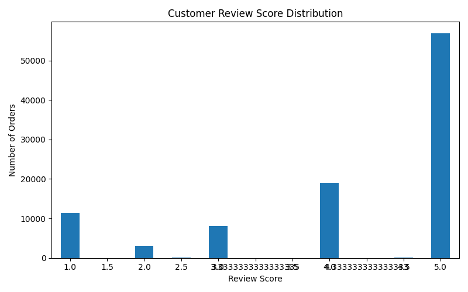
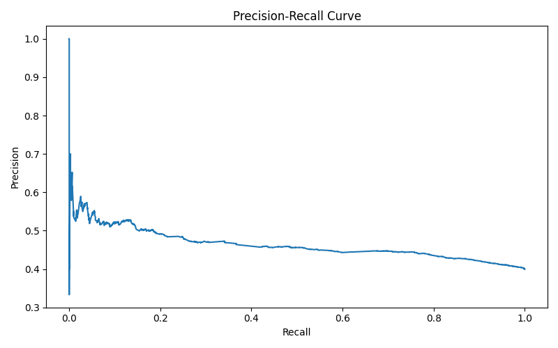
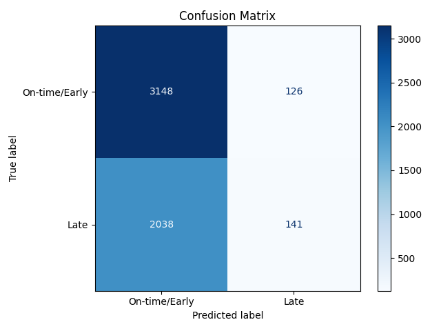
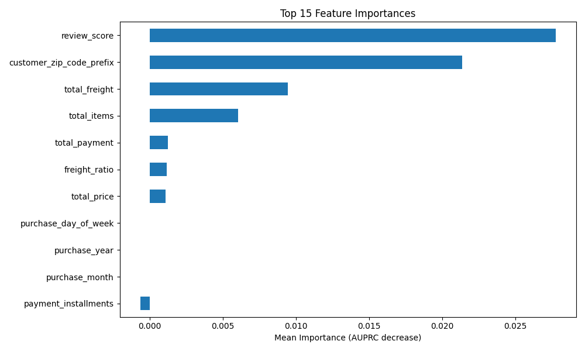

# 📊 Project Visualizations and Execution Results

This folder contains visualizations and execution results from the **Olist Brazilian E-Commerce Analysis and Late Delivery Prediction** project.

These resources help explain business trends, customer satisfaction, delivery performance, and machine learning model evaluation.

## 📈 Business Analysis Visualizations

### 1. Monthly Order Trends

Displays monthly order volume over time.

### 2. Monthly Sales Trends

Shows changes in total sales over time.

### 3. Delivery Delay Distribution

Illustrates delivery timing in days. Negative values represent early deliveries, while positive values represent late deliveries.

### 4. Customer Review Score Distribution

Shows the distribution of customer review scores and helps identify customer satisfaction patterns.

## 🤖 Machine Learning Visualizations

### 5. Model Performance Comparison

Compares the selected model and baseline using AUPRC, precision, recall, and F1-score.

### 6. Precision-Recall Curve

Illustrates the trade-off between precision and recall for the late delivery prediction model.

### 7. Confusion Matrix

Shows the correct and incorrect predictions made by the late delivery prediction model.

### 8. Feature Importance

Highlights the features that contribute most to the trained model's predictions.

## 📝 Execution Results

### 9. Project Execution Output

**File:** `output.txt`

Contains the console output captured during project execution, documenting the workflow, dataset loading, data analysis, model training, evaluation metrics, generated insights, and saved output files.

This file provides a text-based record of project execution without requiring multiple terminal screenshots.

## 🎯 Purpose

These visualizations and execution logs document the project's exploratory data analysis, business insights, and machine learning evaluation.

**Note:** The late delivery prediction model has low recall, meaning it misses many actual late deliveries. This limitation should be considered when interpreting its results.

## 👨‍💻 Author

**Atharv Tushar Bhosale**

